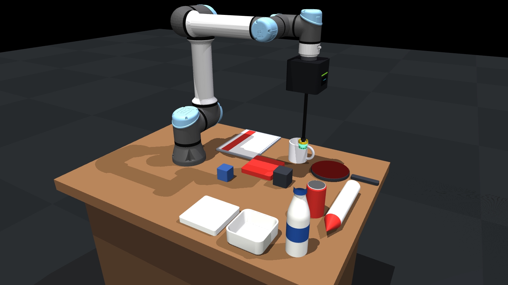
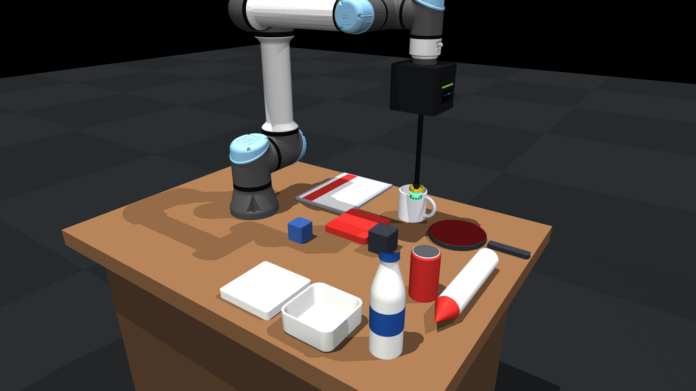

# MuJoCo suction simulation — UR5e + Piab piCOBOT

A deterministic MuJoCo model of the real suction cell: **UR5e** with the
**piCOBOT Electric** pump, the installed **B30-2 silicone bellows cup**
(Ø34/36 mm, 26.2 mm high, yellow collar) on the real 0.370 m extension stack,
mounted on the work table.  It serves two purposes:

1. **Protocol / robot testing** — run picks, pressure sweeps and drop
   detection without hardware, using the same approach → descend → engage →
   lift → hold → release phase structure as the real recorder.
2. **Synthetic RGB-D data** — the two calibrated cameras render colour,
   depth and point clouds, with per-attempt labels in a recordings-like
   directory layout.



```
.
├── README.md
├── pyproject.toml
├── LICENSE
├── NOTICE
├── docs/images/              # README renders
└── mujoco_sim/
    ├── assets/ur5e/          # Menagerie UR5e meshes + reference MJCF
    ├── assets/tool/          # procedural piCOBOT body, B30-2 cup, collar
    ├── assets/objects/       # visual payload meshes (rounded boxes, vessels, ...)
    ├── config.py             # cell layout, object registry, seal calibration
    ├── model.py              # MJCF builder (UR5e + piCOBOT + compliant cup + payloads)
    ├── pneumatics.py         # measured pump source + finite-volume vacuum/leak/vent model
    ├── compliant.py          # deformable-cup seal detection + vacuum force coupling
    ├── suction.py            # legacy rigid-cup controller (fast mode)
    ├── meshgen.py            # piCOBOT / B30-2 / collar + payload visual meshes
    ├── ik.py                 # damped-least-squares Cartesian IK
    ├── env.py                # SuctionEnv (gym-style API)
    ├── cameras.py            # calibrated RGB-D rendering + point clouds
    ├── scripts/
    │   ├── kinematics_check.py
    │   ├── pick_test.py           # one attempt, real recorder phases
    │   ├── sweep_test.py          # pressure sweep / P_min analogue
    │   ├── generate_dataset.py    # synthetic RGB-D dataset
    │   └── view_sim.py            # interactive viewer (keyboard control)
    └── tests/test_sim.py
```

## Installation

A dedicated venv keeps MuJoCo away from the system Python:

```bash
cd picobot-mujoco-sim
python3 -m venv .venv
.venv/bin/pip install -e ".[dev]"
```

For mesh regeneration add the optional trimesh dependency:
`.venv/bin/pip install -e ".[dev,mesh]"`.

Run everything through `.venv/bin/python`; ROS is not needed.

## Quick start

```bash
cd picobot-mujoco-sim

# 1. geometry / IK / servo sanity
.venv/bin/python -m mujoco_sim.scripts.kinematics_check

# 2. one scripted pick (returns non-zero if it fails, use it in CI)
.venv/bin/python -m mujoco_sim.scripts.pick_test \
    --object white_bowl --setpoint 12 --json /tmp/pick.json

# 3. pressure sweep (P_min analogue + calibration check)
.venv/bin/python -m mujoco_sim.scripts.sweep_test \
    --object white_bowl --levels 5 8 11 15 21

# 4. synthetic dataset (RGB-D from external + wrist cameras)
.venv/bin/python -m mujoco_sim.scripts.generate_dataset \
    --objects white_foam white_bowl soda_can --levels 5 8 11 15 21 \
    --attempts 3 --out /tmp/sim_dataset

# 5. interactive viewer
.venv/bin/python -m mujoco_sim.scripts.view_sim
```

Viewer controls work **both** in the viewer window and in the terminal where
you launched it (whichever has focus): `1..9` select object, `d` descend,
`v` vacuum toggle, `+/-` setpoint, `l` lift, `r` release, `h` reset,
`p` status, `q` quit.  The terminal also accepts `set <kPa>`, `vac <kPa>`
and `move x y z` (world metres) — handy when the window does not get
keyboard focus.  `view_sim` needs a display; the other scripts run headless.

Tests:

```bash
.venv/bin/python -m pytest mujoco_sim/tests -q
```

## Python API

```python
import numpy as np
from mujoco_sim import SuctionEnv, TOP_DOWN_R

env = SuctionEnv(objects=["white_bowl"])           # world metres
top = env.object_top_center("white_bowl")

env.move_tip_to(top + [0, 0, 0.09])                # approach (quintic PTP)
env.move_tip_to(top + [0, 0, -0.0002])             # descend into the seal
env.suction.set_cmd(12.0)                          # set_esLvl analogue, kPa
env.hold(1.0)                                      # engage dwell

env.move_tip_to(top + [0, 0, 0.05])                # lift
print(env.suction.part_present,                    # get_pp analogue
      env.suction.vacuum_kpa,                      # gauge kPa
      env.object_clearance_m("white_bowl"))        # real clearance, not body z

env.suction.release()                              # set_vac(0)
env.hold(1.0)
env.close()
```

Helpers: `env.ik(pos, R)` (non-destructive), `env.obs()` (state dict),
`env.capture(dir)` (RGB-D + metadata), `env.object_aabb/speed/clearance`,
`env.reset()` (object yaw randomisation optional via config).

## What is modelled

| Real cell | Simulation |
|---|---|
| UR5e from `ur_description` | Menagerie UR5e (`universal_robots_ur5e`, STL/OBJ meshes, 6 position servos) |
| `tool0 -> suction_cup_tip = 0.370 m` | same transform, site `suction_cup_tip` |
| piCOBOT Electric body | official 120 x 124.4 x 110.2 mm rounded housing, 1.43 kg incl. UR adapter; no connector/camera hardware on the body |
| B30-2 silicone cup (Piab 0101431) | Ø34 mm bellows / Ø36 mm flange, 26.2 mm high, 7 g, transparent green silicone |
| installed collar + extension | Ø39 mm yellow collar, 224 mm Ø12.5 mm black tube, hex fitting (length derived from the measured 0.370 m tip) |
| wrist camera | sensor-only Orbbec at the hand-eye calibration pose (`tool0` frame; the physical bracket/housing is not modelled) |
| default cameras | 1280 x 720, fx = 752.21, fy = 751.99, cx = 644.66, cy = 365.31 (recorded Orbbec stream) |
| Gravity-compensated UR controller | feed-forward `qfrc_bias` on the arm (without it the servos sag ~10 mm) |
| MoveIt PTP/LIN motions | `move_tip_to` quintic joint PTP + DLS IK (no collision planning, empty scene) |
| piCOBOT Electric / B30-2 cup | **deformable**, see "Deformable suction physics" below |
| Suction hold / breakaway | finite-volume vacuum + lip seal + force-limited attachment |
| `get_pp` part-present | latched comparator with seal-loss debounce |
| Foam / paper payloads | rigid core + sprung **soft top skin** (local compression) |
| Payload visuals | rounded/hollow OBJ meshes; hidden primitive collision proxies |
| Table + 2× Orbbec cameras | table/world + calibrated `external` and `wrist` cameras |

## Deformable suction physics

The old rigid cup + `geom_adhesion` model was replaced by a two-part
deformable/contact model calibrated on the same study corpus.

### Compliant cup

The B30 cup sits on a passive **bellows mount**: one axial slide plus two
tilt hinges (spring-damped, calibrated to the silicone bellows), and its lip is
a ring of **12 individually sprung rubber pads** (capsules, Ø5.6 mm pads on a
Ø29 mm ring, 6 mm effective seal band).  Under the arm press and the vacuum
reaction the cup visibly compresses/tilts and the pads conform independently.

| Quantity | value |
|---|---|
| axial stiffness / damping | 1500 N/m / 15 N·s/m (12 mm travel) |
| tilt stiffness / damping | 4 N·m/rad / 0.15 N·m·s/rad (±0.25 rad) |
| lip pads | 12, 1200 N/m each, 4 mm travel, 0.2 g each |
| cup body + collar | 17 g (7 g B30-2 cup + 10 g collar) |
| seal band | 6 mm (B30-2 vertical travel is 14 mm) |

### Lumped vacuum model (`pneumatics.LumpedVacuum`)

| Quantity | Value / source |
|---|---|
| chamber | pump + tube + cup, default 40 cm³ |
| pump source | measured engage peak `40 + 0.7·cmd` → steady `cmd + 1` kPa |
| pump flow | Piab datasheet curve, 0.79 Nl/s at 0 kPa → 0.02 at 67 kPa |
| pump conductance | 6e-7 m³/s/Pa, one-way (non-return valves) |
| seal leak | calibrated so the engage overshoot decays ~35 kPa in ~0.7 s |
| open cup | 8e-9 m³/s/Pa (a sustained open cup out-leaks the pump; a single-step contact flicker does not collapse the chamber) |
| release vent | 2.7e-9 m³/s/Pa (~0.15 s) |
| sensors | filtered `get_vacLvl`, PP at 40 kPa latched with a 0.2 s seal-loss grace, PS at 45 kPa |

The pressure is integrated from air mass conservation with the finite chamber
volume; seal leakage is a function of lip coverage, compression and alignment.
This reproduces the measured settle level (`cmd + 1`) while letting porous or
popped seals droop and drop the part.

### Seal → force → pull-off

The pad contacts give a seal coverage `c` (unique pads in contact / 12),
compression quality and tilt alignment.  The available vacuum force is

```
F_pull = ΔP · A_lip · c · seal_quality · 0.85
```

with `A_lip = π(17 mm)²`, the object-specific `seal_quality`, and a 0.85
safety factor for seal edges/peel.  While the seal exists the payload is
attached kinematically at its captured pose relative to the cup; if the
required support force (`m·g`) exceeds `F_pull`, the seal is released and the
payload falls under the normal rigid-body solver.  This is why the low-pressure
thresholds follow the real corpus.

### Soft payloads

Foam and paper payloads have a rigid core plus a **sprung top skin**: a grid
of flat contact pads (6×6 for foam, 8×10 for the magazine) on vertical
springs.  The skin compresses locally under the cup and recovers, while the
payload stays dynamically stable.  The pads are hidden at render time by
default (`soft_skin_visible=False`) because they read as studs on an otherwise
clean foam/paper surface; set it to `True` to see the compressible skin.  This
is a reduced-order surface-compliance model, not continuum FEM.

### Payload visuals

Every payload in `OBJ_SPECS` has render-only meshes under
`mujoco_sim/assets/objects/` (rounded foam/magazine/cubes, a rounded-square bowl, a
hollow mug with a torus handle, a bottle with cap, a can with a lid, a
table-tennis racket with a rubber face, and a rocket lying on its side).



Regenerate both README renders from the live simulation with
`.venv/bin/python docs/render_images.py`.
Collision stays on cheap primitives (`geoms=`), which are moved to render
group 3 when a visual mesh exists.  The bowl and mug are **hollow**: their
collision is a floor plus a ring of wall boxes, so the cup can descend into
the vessel and seal on the interior floor.  `pick_offset_xy` / `pick_offset_z`
place the vacuum cup on the actual grasp surface (blade centre for the
racket, interior floor for the bowl and mug).

### Seal calibration

`seal_quality` is calibrated from measurements on the real cell
(hold pressures and masses) and the
vacuum force budget.  Low-pressure thresholds observed in sim (2 s hold, 5 cm
lift):

| object | mass | real-cell hold | sim first HOLD (cmd) |
|---|---|---|---|
| white_foam | 50 g | 9.2 kPa | 8 kPa |
| white_bowl | 219 g | 7.0 kPa | 8 kPa |
| magazine | 45 g | 7.0 kPa | 8 kPa |
| soda_can | 370 g | 11.0 kPa | 11 kPa |
| bottle | 600 g | 15.3 kPa | 15 kPa |
| heavy_cube | 1.5 kg | (negative test) | 27 kPa |

The ordering and absolute values are close to the hardware measurements; use the sim
for relative experiments, not as a replacement for hardware P_min.

Objects without a measured real-cell threshold: the `ceramic_mug` (248 g) and
`racket` (168 g) both hold at 5 kPa in sim (the racket's real-cell pick was
floor-censored).  The `rocket` is deliberately a poor suction target: it lies
on its side, so the lip only gets a line contact (`seal_quality=0.20`).

## Scene configuration

All spatial parameters live in `SimConfig` (`config.py`):

- robot base on the table at `(0, 0, 0.72)`, yawed −90° so the Menagerie
  home pose is over the workspace
- table `0.72 m` high, top `1.16 × 0.84 m`
- object spawn poses in `DEFAULT_PLACEMENTS` (no overlaps for the default set)
- tool stack: 12 mm UR adapter + 110.2 mm piCOBOT housing + 221.6 mm extension
  + 26.2 mm B30-2 cup = 0.370 m; masses 1.43 kg pump, 0.03 kg tube,
  0.01 kg collar (no camera-mount mass: the bracket was removed)
- cup: compliant bellows (axial + 2 tilt joints), 12 sprung lip pads, 6 mm
  seal band; `cup_model="compliant"` (default) or `"rigid"` fast fallback
- payloads: render-only OBJ visuals (hollow bowl/mug, racket, bottle, can,
  rounded boxes) over primitive collision proxies; foam/paper additionally
  have a sprung soft top skin
- cameras: external pose/target; wrist camera from
  (``x=-0.0386, y=0.1195, z=0.0642`` in ``tool0``, looking down the tool axis;
  from the real cell's hand-eye calibration);
  optional ``intrinsics_path`` overrides the 1280x720 Orbbec defaults

Change the cell by editing the config and calling `build_scene(...)`:

```bash
.venv/bin/python -m mujoco_sim.scripts.build_scene \
    --objects white_foam white_bowl --out /tmp/scene.xml
```

The MJCF is regenerated on every `SuctionEnv` construction.

### Adding objects

Primitive objects are registered in `OBJ_SPECS`:

```python
"white_plate": ObjectSpec(
    "white_plate", mass_kg=0.162, seal_quality=0.44,
    geoms=(GeomSpec("cylinder", (0.10, 0.0075), (0, 0, 0.0075)),),
)
```

`GeomSpec` supports box / cylinder / sphere / capsule / ellipsoid with
position, euler angles (degrees) and colour; the AABB, inertia and spawn height
are derived from the collision geoms.  Optional `visual_meshes=(VisualMesh(
"file_stem", pos, euler_deg, rgba), ...)` attach render-only OBJ meshes from
`assets/objects/`; the collision primitives are then hidden in group 3.
`pick_offset_xy` and `pick_offset_z` move the suction target from the AABB
centre/top to the real grasp surface.  For a new scanned object, add the OBJ
to `mujoco_sim/assets/objects/`, a `VisualMesh`, and a matching primitive in `geoms`.

## Cameras and synthetic data

`env.capture(dir)` writes per camera:

```
external_rgbd.npz   rgb (H,W,3 uint8), depth (H,W float32, m), K (3,3)
wrist_rgbd.npz
meta.json           time, intrinsics, object poses, cup pose, labels
```

The dataset generator adds `perception/` and `hold/` captures, `outcome.json`
per attempt and a `manifest.json` with the success summary.  Camera frames
use the Orbbec pinhole model (1280×720, fx/fy ≈ 752, matching the recorded
perception stream).  Pass ``SimConfig(intrinsics_path=...)`` to use a
different calibration file.

The tool meshes are generated by ``mujoco_sim/meshgen.py`` from the official
Piab dimensions and committed under ``mujoco_sim/assets/tool``.  Regenerate with
``.venv/bin/python -m mujoco_sim.meshgen`` (needs the
optional ``trimesh`` package).  The same command also regenerates the payload
meshes in ``assets/objects``.  The deformable cup and soft payload skins are
built from MJCF primitives/joints, not meshes.

Rendering needs a GL context.  On a headless machine export
`MUJOCO_GL=egl`; metrics/labels (no rendering) work without any display.

## Known limitations

- **Reduced-order suction contact**: while the seal exists the payload is
  attached kinematically up to the vacuum force limit; continuous friction,
  tangential peel and viscoelastic relaxation are simplified.  The cup
  mechanism and the pneumatic/seal/leak model are the high-fidelity parts.
- **Reduced-order soft payloads**: foam/paper use a sprung contact skin, not
  continuum FEM.  Full flex payloads were tested and are numerically unstable
  at interactive timesteps; they can be added later as a slow high-fidelity
  mode.
- No continuous leak-area growth from surface roughness or object porosity
  beyond the calibrated seal/material leak coefficients.
- The pump uses the measured engage/steady source and the datasheet flow
  limit; RPM/thermal dynamics are simplified.
- No MoveIt collision planning — motions are IK + quintic PTP (the cell is
  empty apart from the table).
- One piCOBOT head (the installed B30-2 silicone cup + custom extension).
  Swap geometry in `_build_picobot` for a different cup/foam gripper; the
  extension length is derived automatically from `tool_length_m`.
- Tool meshes are procedural approximations of the Piab CAD (rounded housing,
  bellows silhouette), not the manufacturer STEP files.
- Payload visual meshes are procedural too; collisions are primitive proxies
  (wall boxes for vessels, a capsule handle for the mug, cylinders for the
  bottle/can/rocket).  A mesh collision hull is intentionally not used: it
  would be slower and makes the suction seal harder to control.
- The black extension, yellow collar and hex fitting are custom parts on this
  cell: their diameters/height were fitted from the recorded wrist images
  (~Ø12.5 mm tube, Ø39 x 9 mm collar), while the total `tool0 -> tip` length is
  the measured 0.370 m.  Adjust `SimConfig` if you have exact drawings.

## Provenance

UR5e model and meshes: [MuJoCo Menagerie](https://github.com/google-deepmind/mujoco_menagerie)
(`universal_robots_ur5e`), Copyright 2018 ROS Industrial Consortium, BSD-3-Clause —
see `mujoco_sim/assets/ur5e/LICENSE`.  Everything else is part of this
repository (MIT).
